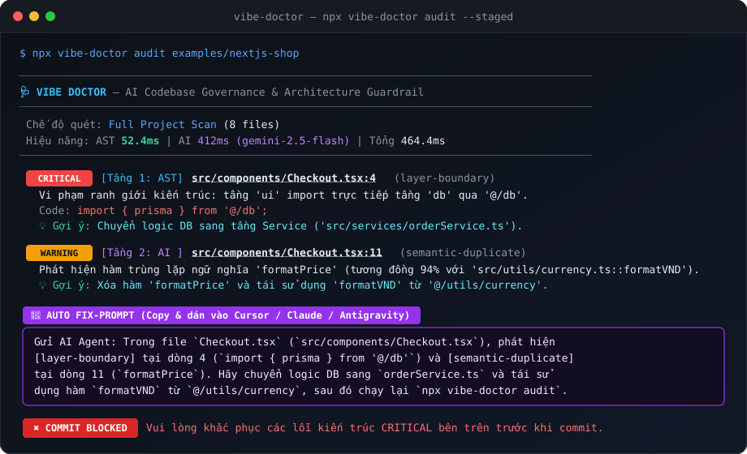
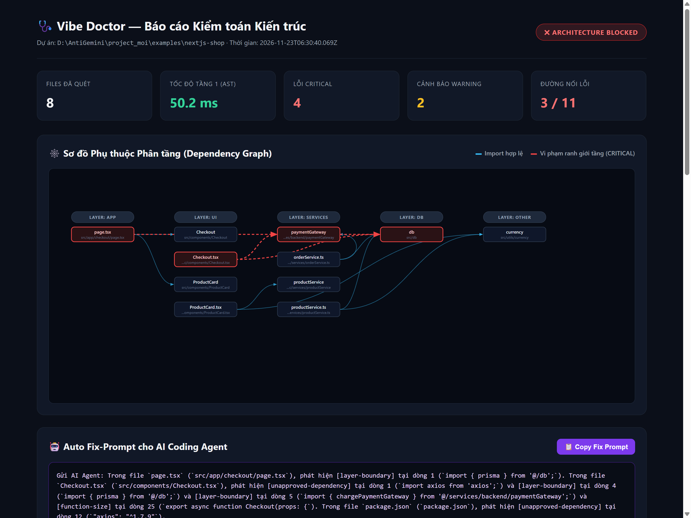
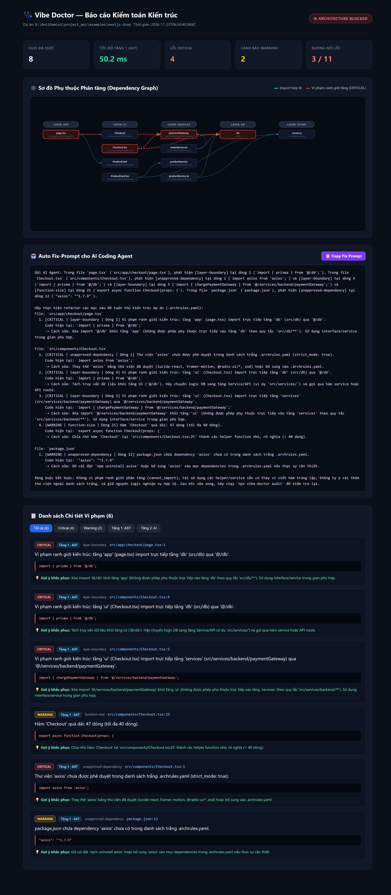
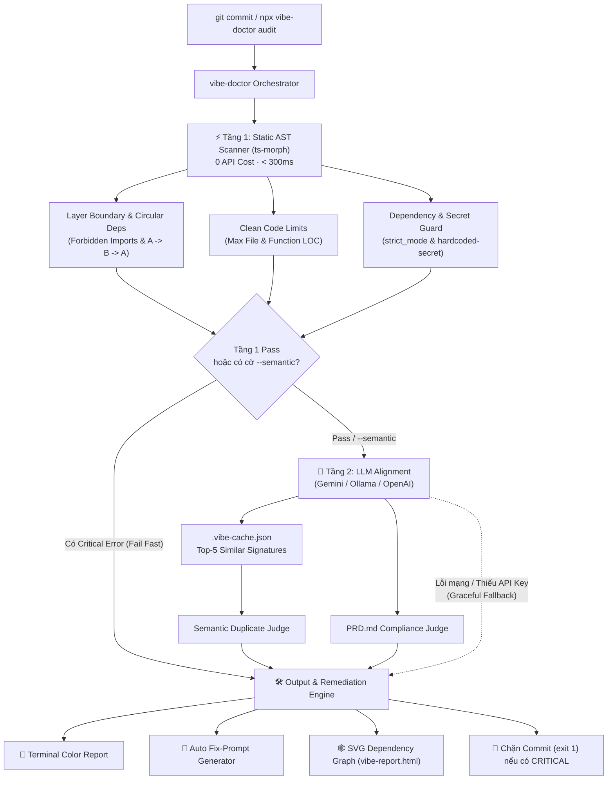
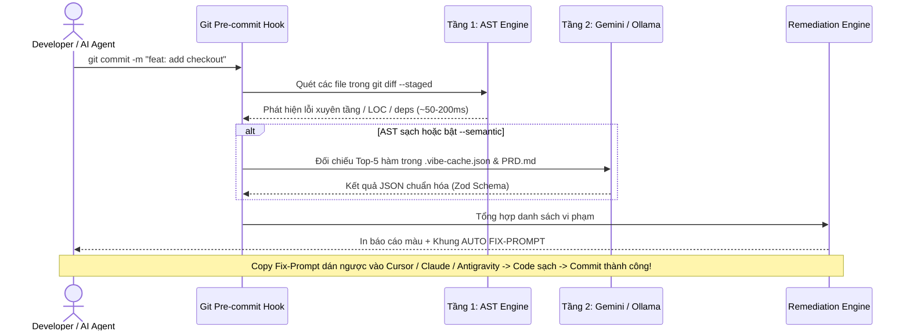

<div align="center">

# 🩺 Vibe Doctor

**AI Codebase Governance & Architecture Guardrail CLI**

*Ngăn chặn triệt để hiện tượng **Architecture Drift** khi lập trình cùng AI Coding Agents (Cursor, Claude Code, Windsurf, Antigravity).*

[](https://github.com/24122050S/Vibe-Doctor/actions/workflows/ci.yml)
[](./tsconfig.json)
[](./package.json)
[](./src/ast/parser.ts)
[](./src/ai/provider.ts)
[](https://github.com/24122050S/Vibe-Doctor)
[](./LICENSE)

[**📖 Cẩm nang Hướng dẫn Sử dụng Chi tiết (Kèm Hình ảnh)**](./docs/USER_GUIDE.md) · [**🏗️ Đặc tả Kiến trúc (RFC)**](./docs/ARCHITECTURE_SPEC.md) · [**📋 Lịch sử Phiên bản**](./CHANGELOG.md)

</div>

---

## 📸 Trải nghiệm Trực quan (Live Demo)

### 1. Báo cáo Console & Auto Fix-Prompt ngay khi `git commit`


### 2. Dashboard Đồ thị Phụ thuộc Phân tầng (`vibe-report.html`)


<details>
<summary>🔎 <b>Bấm để xem ảnh chụp toàn trang báo cáo chi tiết (Full-Page Audit Report)</b></summary>
<br />



</details>

---

## 🎯 Bài toán & Giải pháp

Khi lập trình theo phong cách **Vibe Coding**, các AI Agent thường tối ưu hóa cục bộ trong cửa sổ ngữ cảnh ngắn hạn, dẫn tới **Trôi dạt Kiến trúc (*Architecture Drift*)**:
- ❌ **Xuyên thủng phân tầng:** Tầng giao diện (`src/components/**`, `src/app/**`) gọi thẳng xuống Database (`@/db`) hoặc internal backend gateway.
- ❌ **Trùng lặp ngữ nghĩa:** Tự sinh thêm hàm `formatPrice()` trong khi dự án đã có sẵn utility chuẩn `src/utils/currency.ts::formatVND()`.
- ❌ **Cài đặt thư viện tự phát:** Tự ý import các package ngoài danh sách kiểm duyệt của team.
- ❌ **Đi chệch nghiệp vụ:** Code chạy được nhưng sai điều kiện kinh doanh quy định trong `PRD.md`.

**`vibe-doctor`** đóng vai trò "Bác sĩ kiểm toán kiến trúc" kiêm **Git Pre-commit Guardrail**, kết hợp tốc độ tức thì của AST và khả năng hiểu ngữ nghĩa của LLM, đồng thời tự động sinh **Fix Prompt** để dev dán ngược vào AI Agent sửa code trong một nốt nhạc.

---

## 🏗️ Kiến trúc Hệ thống (Mermaid Diagrams)

### Phễu Kiểm toán 2 Tầng & Remediation Engine



### Vòng lặp Tự chữa lành Kiến trúc cùng AI Coding Agent



---

## 🚀 Cài đặt & Khởi chạy Nhanh

```bash
# 1. Cài đặt dependencies & biên dịch TypeScript
npm install
npm run build

# 2. (Tuỳ chọn) Đăng ký lệnh vibe-doctor dùng toàn cục trên máy
npm link

# 3. Khởi tạo .archrules.yaml theo preset (nextjs | nestjs | react-vite | express) & cài Git hook
npx vibe-doctor init --preset nextjs

# 4. Đồng bộ luật kiến trúc sang .cursor/rules, AGENTS.md & CLAUDE.md (Phòng bệnh chủ động!)
npx vibe-doctor sync-rules

# 5. Quét toàn bộ dự án hiện tại
npx vibe-doctor audit

# 6. Chỉ quét các file đang staged (chế độ dành cho Git pre-commit hook)
npx vibe-doctor audit --staged

# 7. Xuất báo cáo đồ thị phụ thuộc trực quan ra vibe-report.html
npx vibe-doctor report
```

---

## ⚙️ Cấu hình `.archrules.yaml`

Đặt file `.archrules.yaml` tại thư mục gốc của dự án cần bảo vệ (hoặc sinh tự động bằng `npx vibe-doctor init`):

```yaml
version: "1.0"
project_type: "nextjs-clean-arch"

# Bỏ qua thư mục test hoặc script build nếu cần
ignore:
  - "tests/**"

# 1. Quy định ranh giới giữa các tầng
layers:
  app:
    path: "src/app/**"
    cannot_import: ["src/db/**"]
  ui:
    path: "src/components/**"
    cannot_import: ["src/db/**", "src/services/backend/**"]
  services:
    path: "src/services/**"
    cannot_import: ["src/components/**", "src/app/**"]
  db:
    path: "src/db/**"
    cannot_import: ["src/components/**", "src/services/**", "src/app/**"]

# 2. Ngưỡng cảnh báo độ sạch code
thresholds:
  max_file_lines: 300
  max_function_lines: 50

# 3. Danh sách thư viện được phép dùng
dependencies:
  allowed_ui: ["lucide-react", "framer-motion", "@radix-ui/*"]
  allowed_validation: ["zod"]
  strict_mode: true

# 4. LLM Configuration (Tầng 2)
ai_eval:
  provider: "gemini" # gemini | ollama | openai
  model: "gemini-2.5-flash"
  check_semantic_duplication: true
  check_prd_compliance: true
  prd_path: "PRD.md"
```

### Tự động nạp `.env` / `.env.local` cho Tầng 2 (LLM)
`vibe-doctor` **tự động đọc file `.env.local` và `.env`** trong thư mục dự án (ưu tiên biến môi trường hệ thống > `.env.local` > `.env`).

```bash
cp .env.example .env
# Kiểm tra cấu hình & gửi ping test kết nối LLM thật:
npx vibe-doctor check-ai --ping
```

| Provider | Cấu hình trong `.archrules.yaml` | Biến môi trường trong `.env` / `.env.local` |
| :--- | :--- | :--- |
| **Google Gemini** | `provider: "gemini"` | `GEMINI_API_KEY="your-api-key"` |
| **Ollama (Local)** | `provider: "ollama"` | `OLLAMA_HOST="http://localhost:11434"` (mặc định không cần key) |
| **OpenAI / Compatible** | `provider: "openai"` | `OPENAI_API_KEY="your-api-key"` |

---

## 🛠️ Tham chiếu Lệnh CLI

| Lệnh | Mô tả | Cờ tùy chọn nổi bật |
| :--- | :--- | :--- |
| `vibe-doctor audit [dir]` | Kiểm toán kiến trúc 2 tầng và sinh Auto Fix-Prompt | `-s, --staged`, `--semantic`, `--no-ai`, `--strict`, `--json`, `--html [file]`, `-c <path>` |
| `vibe-doctor watch [dir]` | Giám sát thời gian thực — tự động quét AST mỗi khi AI lưu file | `--semantic`, `--strict`, `--html [file]`, `-c <path>` |
| `vibe-doctor sync-rules [dir]` | Sinh `.cursor/rules/vibe-doctor.mdc`, `AGENTS.md`, `CLAUDE.md` từ `.archrules.yaml` + danh sách hàm sẵn có | `-t, --targets <list>`, `--no-index`, `-c <path>` |
| `vibe-doctor init [dir]` | Tạo `.archrules.yaml` theo preset & gắn Git `pre-commit` hook | `-p, --preset <nextjs\|nestjs\|react-vite\|express>`, `-f, --force`, `--no-hook` |
| `vibe-doctor index [dir]` | Quét AST lập chỉ mục hàm vào `.vibe-cache.json` | — |
| `vibe-doctor report [dir]` | Tạo dashboard `vibe-report.html` kèm Dependency Graph | `-o <output>`, `--semantic`, `--no-ai`, `-c <path>` |
| `vibe-doctor check-ai [dir]` | Kiểm tra `.env` / API Key & ping thử kết nối LLM Tầng 2 | `--ping`, `-c <path>` |
| `vibe-doctor mcp [dir]` | Khởi chạy **MCP Server (stdio)** cho Antigravity / Cursor / Claude | — |

---

## 🔌 Tích hợp MCP Server cho Antigravity / Cursor / Claude Desktop

Thay vì phải copy-paste `Fix Prompt` thủ công, bạn có thể gắn `vibe-doctor` trực tiếp làm **Model Context Protocol (MCP) Server** để AI Agent tự tra cứu hàm sẵn có (`vibe_search_functions`), tự kiểm toán (`vibe_audit`) và tự đồng bộ rule (`vibe_sync_rules`) trong vòng lặp khép kín:

```json
{
  "mcpServers": {
    "vibe-doctor": {
      "command": "vibe-doctor",
      "args": ["mcp"]
    }
  }
}
```
*(Nếu chưa chạy `npm link`, bạn có thể trỏ `"command": "node"`, `"args": ["D:/duong-dan/Vibe-Doctor/bin/vibe-doctor.js", "mcp"]` hoặc `"command": "npx"`, `"args": ["-y", "vibe-doctor", "mcp"]`).*

---

## 🧪 Thử nghiệm ngay với Bộ Dự án Mẫu (Before vs After Fix-Prompt)

Kho mã nguồn đi kèm 2 phiên bản đối chứng để bạn trải nghiệm trọn vẹn vòng lặp kiểm toán & tự chữa lành kiến trúc:
- 🔴 **[`examples/nextjs-shop`](./examples/nextjs-shop) (Before):** Mô phỏng các lỗi *Vibe Coding* kinh điển (`Checkout.tsx` gọi thẳng `@/db`, dùng `axios` chưa duyệt, hàm trùng `formatPrice` so với `formatVND`, và sai lệch quy tắc miễn phí vận chuyển trong `PRD.md`).
- 🟢 **[`examples/nextjs-shop-clean`](./examples/nextjs-shop-clean) (After):** Phiên bản đã refactor theo đúng từng chỉ dẫn trong **Auto Fix-Prompt** của `vibe-doctor`, vượt qua kiểm toán `--strict` với **0 lỗi**.

```bash
# 1. Quét bản lỗi (~50ms) -> Bị chặn commit (4 CRITICAL, 2 WARNING) + sinh Auto Fix-Prompt
node bin/vibe-doctor.js audit examples/nextjs-shop --no-ai

# 2. Quét bản đã sửa theo Auto Fix-Prompt -> PASSED xanh mượt (0 CRITICAL, 0 WARNING)
node bin/vibe-doctor.js audit examples/nextjs-shop-clean --strict --no-ai

# 3. Sinh báo cáo đồ thị phụ thuộc tương tác vibe-report.html
node bin/vibe-doctor.js report examples/nextjs-shop --no-ai

# 4. Chạy đầy đủ cả Tầng 1 + Tầng 2 (sau khi điền GEMINI_API_KEY vào .env)
node bin/vibe-doctor.js audit examples/nextjs-shop --semantic
```

---

## 📂 Cấu trúc Mã nguồn

```text
vibe-doctor/
├── bin/
│   └── vibe-doctor.js            # Executable CLI entry point
├── docs/assets/                  # Ảnh chụp báo cáo HTML & minh họa Terminal
├── examples/nextjs-shop/         # Dự án Next.js mẫu dùng để demo & kiểm thử
├── src/
│   ├── index.ts                  # Orchestrator kiểm toán 2 tầng & Public API
│   ├── cli.ts                    # Định nghĩa các lệnh Commander CLI
│   ├── types.ts                  # Clean domain interfaces
│   ├── config/
│   │   ├── schema.ts             # Zod schema cho .archrules.yaml
│   │   └── loader.ts             # Parser YAML & cấu hình mặc định Next.js
│   ├── ast/
│   │   ├── parser.ts             # Fast ts-morph context & path alias resolver
│   │   ├── rules/
│   │   │   ├── layerBoundary.ts  # Kiểm tra ranh giới import giữa các tầng
│   │   │   ├── fileSize.ts       # Kiểm tra kích thước file & hàm
│   │   │   └── depsCheck.ts      # Kiểm tra whitelist/banlist thư viện
│   │   └── indexer.ts            # Lập chỉ mục chữ ký hàm & lọc Top-5 ứng viên
│   ├── ai/
│   │   ├── provider.ts           # Adapter đa nền tảng (Gemini, Ollama, OpenAI)
│   │   ├── prompts.ts            # System Prompts & Auto Fix-Prompt Generator
│   │   ├── semanticChecker.ts    # Phát hiện hàm trùng lặp ngữ nghĩa
│   │   └── prdChecker.ts         # Đối chiếu logic nghiệp vụ với PRD.md
│   ├── reporters/
│   │   ├── terminal.ts           # Báo cáo màu trên Console
│   │   ├── htmlReport.ts         # Bộ dựng đồ thị SVG Swimlane Dependency Graph
│   │   └── htmlTemplate.ts       # Giao diện HTML/CSS standalone
│   └── utils/
│       ├── env.ts                # Tự động đọc .env.local & .env
│       ├── git.ts                # Trích xuất git diff & staged files
│       ├── init.ts               # Khởi tạo .archrules.yaml & Git hooks
│       └── logger.ts             # System logger
├── templates/
│   └── .archrules.yaml           # Cấu hình mẫu cho vibe-doctor init
└── tests/
    └── vibe-doctor.test.ts       # Bộ kiểm thử tích hợp & benchmark hiệu năng (<300ms)
```

---

## ✅ Kiểm thử & Đảm bảo Chất lượng

```bash
# Chạy toàn bộ unit tests & benchmark tốc độ AST
npm test

# Tự kiểm toán chính kiến trúc của vibe-doctor ở chế độ nghiêm ngặt
npm run build && node bin/vibe-doctor.js audit --strict --no-ai
```

---

## 📄 Giấy phép (License)

Phát hành theo giấy phép **MIT License**. Xem thêm tài liệu thiết kế chi tiết tại [`docs/ARCHITECTURE_SPEC.md`](./docs/ARCHITECTURE_SPEC.md) và lịch sử phiên bản tại [`CHANGELOG.md`](./CHANGELOG.md).
