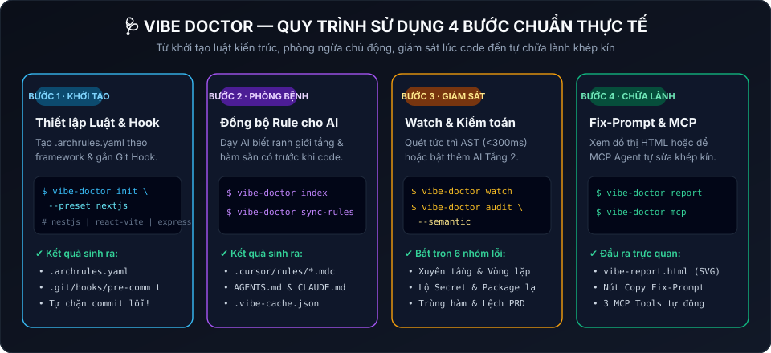
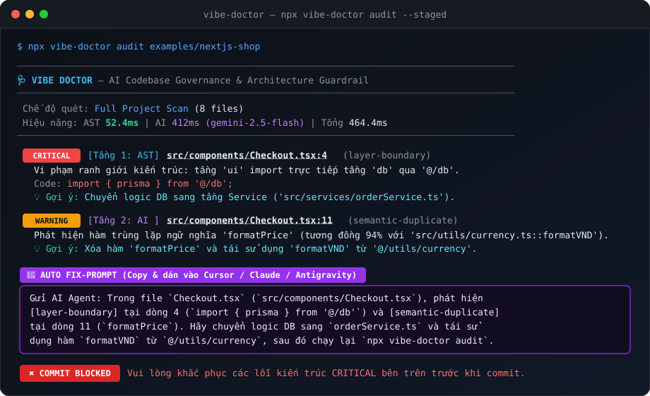
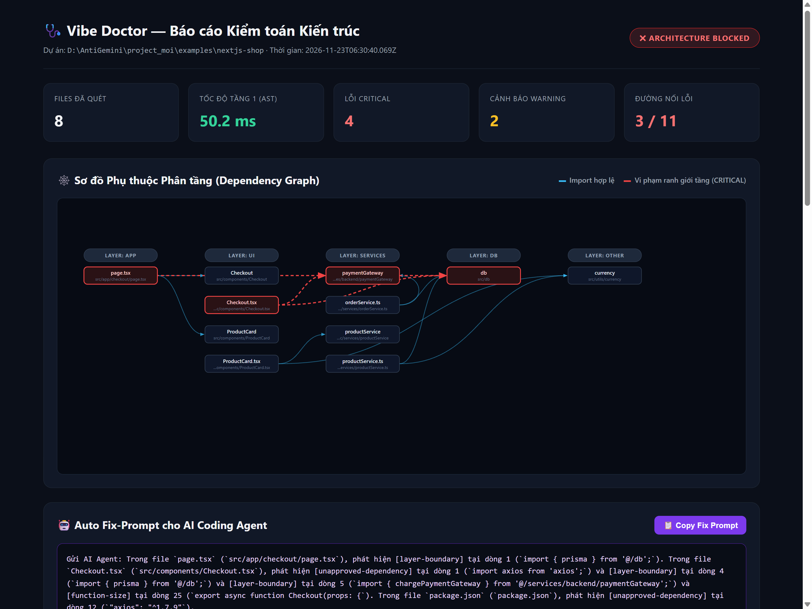
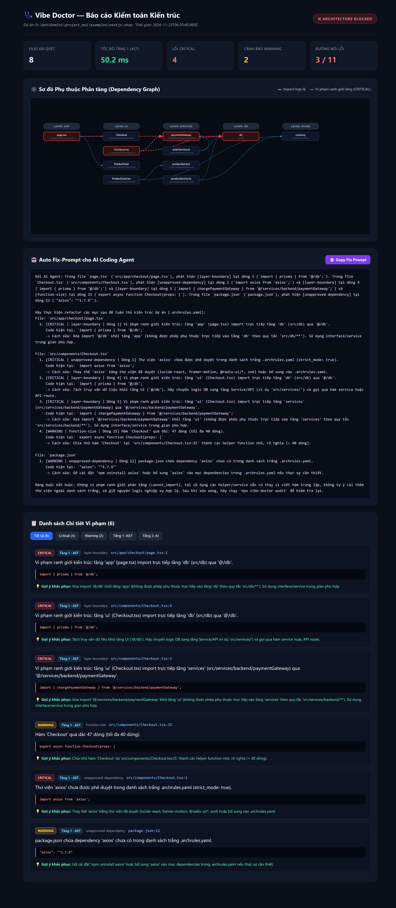
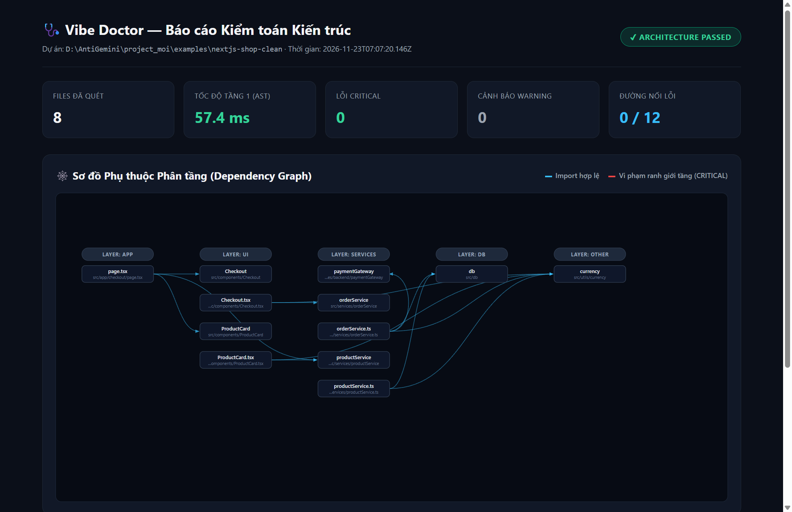
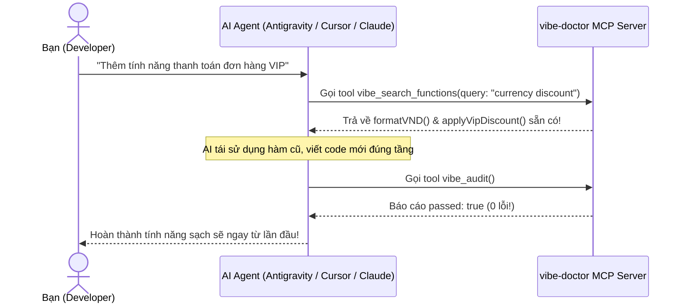

# 📖 Cẩm nang Hướng dẫn Sử dụng Chi tiết — Vibe Doctor (`v1.4.1`)

> **Tài liệu hướng dẫn toàn diện từng bước (từ cơ bản đến nâng cao) kèm hình ảnh trực quan giúp bạn làm chủ `vibe-doctor` trong mọi dự án AI Coding.**

---

## 📑 Mục lục

1. [Tổng quan Quy trình 4 Bước](#1-tổng-quan-quy-trình-4-bước)
2. [Cài đặt & Thiết lập Ban đầu](#2-cài-đặt--thiết-lập-ban-đầu)
3. [Bước 1: Khởi tạo Dự án theo Preset (`init`)](#3-bước-1-khởi-tạo-dự-án-theo-preset-init)
4. [Giải phẫu File Cấu hình `.archrules.yaml`](#4-giải-phẫu-file-cấu-hình-archrulesyaml)
5. [Bước 2: Phòng bệnh Chủ động cho AI (`index` & `sync-rules`)](#5-bước-2-phòng-bệnh-chủ-động-cho-ai-index--sync-rules)
6. [Bước 3: Quét Kiểm toán & Giám sát Thời gian thực (`audit` & `watch`)](#6-bước-3-quét-kiểm-toán--giám-sát-thời-gian-thực-audit--watch)
7. [Bước 4: Đọc Đồ thị HTML & Sửa lỗi Trước / Sau (`report`)](#7-bước-4-đọc-đồ-thị-html--sửa-lỗi-trước--sau-report)
8. [Bật Tầng 2 AI với Google Gemini / Ollama / OpenAI (`check-ai`)](#8-bật-tầng-2-ai-với-google-gemini--ollama--openai-check-ai)
9. [Tích hợp MCP Server Khép kín vào Antigravity / Cursor / Claude (`mcp`)](#9-tích-hợp-mcp-server-khép-kín-vào-antigravity--cursor--claude-mcp)
10. [Ngoại lệ Có Kiểm soát & Giải đáp Thắc mắc (FAQ)](#10-ngoại-lệ-có-kiểm-soát--giải-đáp-thắc-mắc-faq)

---

## 1. Tổng quan Quy trình 4 Bước

`vibe-doctor` không chỉ chặn lỗi lúc bạn gõ `git commit`, mà bảo vệ dự án xuyên suốt **4 giai đoạn** của vòng đời lập trình cùng AI:



---

## 2. Cài đặt & Thiết lập Ban đầu

### Cách 1: Chạy trực tiếp qua `npx` (khi gói đã publish lên npm)
Không cần cài đặt trước, đứng tại bất kỳ thư mục dự án nào và gõ:
```bash
npx vibe-doctor init
npx vibe-doctor audit
```

### Cách 2: Cài đặt từ mã nguồn (Dùng toàn cục trên máy cá nhân)
```bash
git clone https://github.com/24122050S/Vibe-Doctor.git
cd Vibe-Doctor
npm install
npm run build
npm link
```

> **💡 Lưu ý cho người dùng Windows PowerShell:**
> Nếu Windows PowerShell trên máy bạn đang bật chính sách chặn script `.ps1` (`Restricted`), hãy gõ lệnh kèm hậu tố `.cmd` (tương tự `npm.cmd`):
> ```powershell
> vibe-doctor.cmd --version
> vibe-doctor.cmd audit D:\du-an-cua-ban
> ```
> Trong **Command Prompt (`cmd`)** hoặc **Git Bash**, bạn gõ `vibe-doctor` bình thường.

---

## 3. Bước 1: Khởi tạo Dự án theo Preset (`init`)

Khi bắt đầu bảo vệ một dự án mới, hãy di chuyển vào thư mục dự án đó và chạy lệnh `init` kèm bộ **Preset** phù hợp với công nghệ bạn đang dùng:

```bash
# 1. Dự án Next.js App Router (Mặc định)
vibe-doctor init --preset nextjs

# 2. Dự án Backend NestJS (Controller -> Service -> Domain -> Repository)
vibe-doctor init --preset nestjs

# 3. Dự án Frontend React + Vite (Pages -> Components -> Hooks/Store -> API)
vibe-doctor init --preset react-vite

# 4. Dự án Backend Express / Node.js (Routes -> Controllers -> Services -> DB)
vibe-doctor init --preset express
```

**Chuyện gì xảy ra sau khi chạy `init`?**
1. Sinh file luật kiến trúc **`.archrules.yaml`** ngay tại gốc dự án.
2. Tự động nhận diện `.husky/pre-commit` (nếu dự án dùng Husky) hoặc `.git/hooks/pre-commit` (Git thuần) để gắn chốt chặn tự động `npx --no-install vibe-doctor audit --staged` mỗi khi ai đó chạy `git commit`!
   - *Mẹo:* Dùng `--force` nếu muốn ghi đè `.archrules.yaml` cũ, hoặc `--no-hook` nếu chưa muốn gắn Git hook.

---

## 4. Giải phẫu File Cấu hình `.archrules.yaml`

Bạn có thể mở file `.archrules.yaml` để tinh chỉnh ranh giới phân tầng cho khớp 100% với cấu trúc thư mục thực tế của team:

```yaml
version: "1.0"
project_type: "nextjs-clean-arch"

# Bỏ qua các thư mục không cần kiểm toán kiến trúc
ignore:
  - "tests/**"
  - "scripts/**"

# 1. RANH GIỚI PHÂN TẦNG (Layer Boundaries)
layers:
  app:
    path: "src/app/**"
    cannot_import:
      - "src/db/**"                  # Trang Next.js không được chọc thẳng vào DB
  ui:
    path: "src/components/**"
    cannot_import:
      - "src/db/**"                  # UI tuyệt đối không gọi trực tiếp Prisma/DB
      - "src/services/backend/**"    # UI không gọi thẳng cổng thanh toán nội bộ
  services:
    path: "src/services/**"
    cannot_import:
      - "src/components/**"          # Tầng nghiệp vụ không được phụ thuộc ngược vào UI
      - "src/app/**"
  db:
    path: "src/db/**"
    cannot_import:
      - "src/components/**"
      - "src/services/**"
      - "src/app/**"

# 2. NGƯỠNG ĐỘ SẠCH CODE & BẢO MẬT (Thresholds & Guards)
thresholds:
  max_file_lines: 300                # Cảnh báo nếu file dài quá 300 dòng
  max_function_lines: 50             # Cảnh báo nếu 1 hàm dài quá 50 dòng
  detect_circular_dependencies: true # Chặn vòng lặp import A -> B -> A
  detect_hardcoded_secrets: true     # Chặn lộ API Key / chuỗi kết nối DB chứa mật khẩu

# 3. DANH SÁCH TRẮNG THƯ VIỆN (Approved Dependencies)
dependencies:
  allowed_ui:
    - "lucide-react"
    - "framer-motion"
    - "@radix-ui/*"                  # Hỗ trợ ký tự đại diện wildcard (*)
  allowed_validation:
    - "zod"
  banned:
    - "moment"                       # Cấm tuyệt đối các thư viện quá nặng/lỗi thời
  strict_mode: true                  # true = Mọi package ngoài danh sách allowed_* đều bị chặn!

# 4. CẤU HÌNH TẦNG 2 AI (LLM Semantic & PRD Judge)
ai_eval:
  provider: "gemini"                 # Hỗ trợ: "gemini" | "ollama" | "openai"
  model: "gemini-2.5-flash"
  check_semantic_duplication: true   # Bắt hàm viết mới trùng lặp ý nghĩa với hàm cũ
  check_prd_compliance: true         # Đối chiếu logic hàm với tài liệu PRD.md
  prd_path: "PRD.md"
  similarity_threshold: 0.80         # Độ tương đồng >= 80% sẽ phát cảnh báo
  max_ai_checks: 15                  # Giới hạn số lượt hỏi LLM tối đa mỗi lần chạy
```

---

## 5. Bước 2: Phòng bệnh Chủ động cho AI (`index` & `sync-rules`)

Tại sao phải đợi AI viết code sai rồi mới sửa, trong khi ta có thể **dạy AI biết trước toàn bộ luật kiến trúc và các hàm có sẵn**?

```bash
# 1. Quét toàn bộ dự án để lập danh bạ chữ ký hàm vào .vibe-cache.json
vibe-doctor index

# 2. Xuất tự động luật kiến trúc + danh sách hàm sẵn có cho các AI Coding Agents
vibe-doctor sync-rules
```

Lệnh `sync-rules` tự động tạo/cập nhật 3 file hướng dẫn chuẩn chỉnh:
- **`.cursor/rules/vibe-doctor.mdc`**: Tự động nạp vào mọi phiên chat của **Cursor IDE** (`alwaysApply: true`).
- **`AGENTS.md`**: Chuẩn chung được **Antigravity, OpenAI Codex, GitHub Copilot, Windsurf** tự động đọc.
- **`CLAUDE.md`**: Được **Claude Code** tự động đọc ngay khi mở dự án.
- *(Tuỳ chọn)* Thêm `--targets cursor,agents,claude,windsurf` để sinh thêm `.windsurfrules`.

> **🛡️ An toàn tuyệt đối dữ liệu cá nhân:** `sync-rules` chỉ ghi vào bên trong cặp thẻ đánh dấu `<!-- VIBE-DOCTOR:START --> ... <!-- VIBE-DOCTOR:END -->`. Mọi ghi chú riêng bạn viết bên trên hoặc bên dưới trong `CLAUDE.md` / `AGENTS.md` đều được **giữ nguyên 100%**.

---

## 6. Bước 3: Quét Kiểm toán & Giám sát Thời gian thực (`audit` & `watch`)

### 6.1. Quét kiểm toán theo yêu cầu (`audit`)

```bash
# Quét toàn bộ dự án (Tầng 1 AST + Tầng 2 AI nếu thỏa điều kiện)
vibe-doctor audit

# Chỉ quét siêu tốc Tầng 1 AST (< 300ms, không tốn 1 đồng API nào)
vibe-doctor audit --no-ai

# Chỉ quét các file đang nằm trong `git add` (chế độ của pre-commit hook)
vibe-doctor audit --staged

# Chế độ nghiêm ngặt cho CI/CD (chặn luôn cả mức WARNING)
vibe-doctor audit --strict --no-ai

# Xuất kết quả JSON thuần để tích hợp script tự động
vibe-doctor audit --json
```

Khi phát hiện vi phạm, `vibe-doctor` sẽ in báo cáo phân màu rõ ràng trên Terminal kèm khung **🤖 AUTO FIX-PROMPT** đóng hộp sẵn sàng để bạn copy dán ngược vào AI sửa lỗi:



### 6.2. Giám sát thời gian thực trong lúc AI đang code (`watch`)

Mở một tab Terminal phụ bên cạnh trình soạn thảo và chạy:
```bash
vibe-doctor watch --html
```
Cứ mỗi lần AI Agent bấm lưu bất kỳ file `.ts` / `.tsx` nào, màn hình Terminal sẽ tự làm mới sau `250ms`, quét lại toàn bộ kiến trúc trong chớp mắt và cập nhật luôn file đồ thị `vibe-report.html`!

---

## 7. Bước 4: Đọc Đồ thị HTML & Sửa lỗi Trước / Sau (`report`)

Để nhìn toàn cảnh bức tranh phụ thuộc giữa các tầng trong dự án, hãy chạy:
```bash
vibe-doctor report
```
Sau đó mở file **`vibe-report.html`** vừa được tạo ra trên trình duyệt bất kỳ:

### 🔴 TRƯỚC KHI SỬA (`examples/nextjs-shop` — Bị chặn do vi phạm ranh giới tầng)
- Trạng thái góc phải báo đỏ **`✖ ARCHITECTURE BLOCKED`** (`4 Critical`, `2 Warning`, `3 / 11` đường nối lỗi).
- Trên sơ đồ **Dependency Graph**, các đường import xuyên tầng trái phép (`page.tsx -> db`, `Checkout.tsx -> db`, `Checkout.tsx -> paymentGateway`) **nhấp nháy nét đứt màu đỏ** cực kỳ dễ nhận diện.
- Ngay bên dưới sơ đồ có nút tím **`📋 Copy Fix Prompt`** — bấm 1 click để chép toàn bộ chỉ dẫn khắc phục đưa cho AI Agent!



<details>
<summary>🔎 <b>Xem thêm phần Danh sách Chi tiết Vi phạm & Bộ lọc tương tác ở nửa dưới trang báo cáo</b></summary>
<br />



</details>

---

### 🟢 SAU KHI DÁN AUTO FIX-PROMPT CHO AI SỬA (`examples/nextjs-shop-clean` — Đạt chuẩn 100%)
Sau khi AI Agent thực hiện refactor theo đúng hướng dẫn của `Fix Prompt` (đưa logic DB về `orderService.ts`, gỡ `axios`, tái sử dụng `formatVND`), chạy lại `vibe-doctor report` sẽ cho ra sơ đồ kiến trúc sạch bóng:
- Trạng thái chuyển sang màu xanh ngọc **`✔ ARCHITECTURE PASSED`** (`0 Critical`, `0 Warning`, `0 / 12` đường nối lỗi).
- Mọi mũi tên phụ thuộc đều đi đúng chiều từ `APP -> UI -> SERVICES -> DB / OTHER`!



---

## 8. Bật Tầng 2 AI với Google Gemini / Ollama / OpenAI (`check-ai`)

Tầng 2 giúp bắt những lỗi mà cú pháp tĩnh không nhìn thấy được: **Hàm trùng lặp ngữ nghĩa** (ví dụ `formatPrice` giống hệt `formatVND`) và **Code làm sai quy định nghiệp vụ trong `PRD.md`**.

### Bước 8.1: Tạo file `.env` (hoặc `.env.local`)
`vibe-doctor` tự động tìm đọc `.env.local` và `.env` trong dự án mà không cần bạn gõ lệnh `export` thủ công:

```bash
cp .env.example .env
```

Điền cấu hình tương ứng với Provider bạn chọn:
- **Dùng Google Gemini *(Khuyên dùng — Nhanh & có gói miễn phí)*:**
  Lấy key tại [Google AI Studio](https://aistudio.google.com/apikey) rồi điền vào `.env`:
  ```env
  GEMINI_API_KEY=AIzaSy...
  ```
- **Dùng Ollama chạy Offline trên máy cá nhân *(Miễn phí 100%, bảo mật tuyệt đối)*:**
  Đổi `ai_eval.provider: "ollama"` và `model: "qwen2.5-coder:7b"` (hoặc `llama3.1`) trong `.archrules.yaml`, bật ứng dụng Ollama lên là chạy ngay không cần API Key!
- **Dùng OpenAI:**
  Đổi `ai_eval.provider: "openai"`, `model: "gpt-4o-mini"` và điền `OPENAI_API_KEY=sk-...` vào `.env`.

### Bước 8.2: Kiểm tra kết nối bằng `check-ai --ping`
```bash
vibe-doctor check-ai --ping
```
Nếu màn hình hiện `✔ Kết nối gemini (gemini-2.5-flash) thành công! Phản hồi: {"status":"ok"}`, bạn đã sẵn sàng chạy kiểm toán ngữ nghĩa sâu bất cứ lúc nào với cờ `--semantic`:
```bash
vibe-doctor audit --semantic
```

---

## 9. Tích hợp MCP Server Khép kín vào Antigravity / Cursor / Claude (`mcp`)

Đây là chế độ mạnh mẽ nhất của `vibe-doctor`: gắn trực tiếp vào AI IDE qua giao thức **Model Context Protocol (MCP)** để AI tự giác kiểm tra và tự sửa lỗi trước khi trả lời bạn!



### Cấu hình JSON mẫu:
Thêm đoạn sau vào file cấu hình MCP của công cụ bạn dùng:
- **Antigravity:** `~/.gemini/config/mcp_config.json`
- **Cursor IDE:** `.cursor/mcp.json`
- **Claude Desktop:** `claude_desktop_config.json`

```json
{
  "mcpServers": {
    "vibe-doctor": {
      "command": "node",
      "args": ["D:/duong-dan-toi/Vibe-Doctor/bin/vibe-doctor.js", "mcp"]
    }
  }
}
```
*(Nếu đã cài qua npm toàn cục trên macOS/Linux hoặc CMD, có thể viết gọn `"command": "vibe-doctor", "args": ["mcp"]`).*

---

## 10. Ngoại lệ Có Kiểm soát & Giải đáp Thắc mắc (FAQ)

### ❓ Làm sao bỏ qua cảnh báo cho 1 dòng code đặc biệt (ví dụ script `seed.ts` cần gọi thẳng DB)?
Đặt chú thích `// vibe-doctor-ignore-next-line` ngay phía trên dòng đó (hoặc `// vibe-ignore` ở cuối dòng):
```ts
// vibe-doctor-ignore-next-line
import { prisma } from '@/db';
```
`vibe-doctor` sẽ bỏ qua đúng dòng được đánh dấu mà vẫn bảo vệ nghiêm ngặt toàn bộ các dòng còn lại trong dự án!

### ❓ Nếu đang trên máy bay / mất mạng Internet thì Git pre-commit hook có bị treo không?
**Không bao giờ!**
1. Ở chế độ mặc định, nếu Tầng 1 (AST offline) phát hiện lỗi `CRITICAL`, công cụ chặn ngay lập tức mà không gọi mạng.
2. Kể cả khi Tầng 2 được gọi mà không có Internet hoặc hết hạn mức API Key, cơ chế **Graceful Fallback** sẽ tự động chuyển về kết quả Tầng 1 AST sau timeout an toàn và **không bao giờ làm crash tiến trình `git commit`**.

### ❓ Danh sách toàn bộ 8 mã quy tắc (`ruleId`) mà `vibe-doctor` kiểm tra là gì?

| Mã Quy tắc (`ruleId`) | Tầng | Mức độ mặc định | Ý nghĩa bảo vệ |
| :--- | :---: | :---: | :--- |
| `layer-boundary` | Tầng 1 · AST | `CRITICAL` | Chặn import xuyên tầng trái phép quy định trong `cannot_import` |
| `circular-dependency` | Tầng 1 · AST | `CRITICAL` | Chặn vòng lặp phụ thuộc runtime `A -> B -> ... -> A` (bỏ qua `import type`) |
| `hardcoded-secret` | Tầng 1 · AST | `CRITICAL` | Chặn lộ API Key, Token, Private Key, DB URI chứa mật khẩu |
| `unapproved-dependency` | Tầng 1 · AST | `CRITICAL` / `WARNING` | Chặn dùng thư viện bị cấm (`banned`) hoặc chưa duyệt (`strict_mode: true`) |
| `file-size` | Tầng 1 · AST | `WARNING` | Cảnh báo file phình to vượt ngưỡng `max_file_lines` |
| `function-size` | Tầng 1 · AST | `WARNING` | Cảnh báo hàm quá dài vượt ngưỡng `max_function_lines` |
| `semantic-duplicate` | Tầng 2 · AI | `WARNING` | Phát hiện hàm viết mới trùng lặp ngữ nghĩa với hàm đã có trong `.vibe-cache.json` |
| `prd-drift` | Tầng 2 · AI | `CRITICAL` / `WARNING` | Phát hiện logic hàm đi chệch khỏi điều kiện nghiệp vụ trong `PRD.md` |
